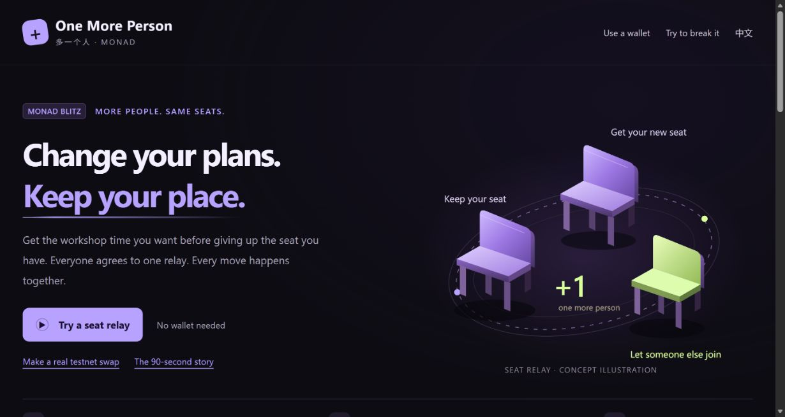

# One More Person · 多一个人



**Change your workshop time without gambling away the seat you already have.**

One More Person coordinates seat exchanges between independent organizers. Everyone approves the same complete plan. Your old seat is released only when you receive the new seat you accepted. All moves happen together; an invalid plan leaves every existing seat unchanged.

Built for [Monad Blitz@Guangzhou](https://mojo.devnads.com/events/18) on **Monad Testnet, chain ID 10143**. The app is English-first, with Chinese available.

[Try the app](https://one-more-person-guangzhou.justdog33.chatgpt.site) · [Try to break it](https://one-more-person-guangzhou.justdog33.chatgpt.site/break.html) · [Use real wallets](https://one-more-person-guangzhou.justdog33.chatgpt.site/live.html) · [The pitch](https://one-more-person-guangzhou.justdog33.chatgpt.site/pitch.html) · [中文演示](https://one-more-person-guangzhou.justdog33.chatgpt.site/zh.html)

## The three-seat example

Alice needs a later time. Bob can move to Sunday. Charlie is waiting for Saturday morning.

| Seat | Before | After everyone accepts |
| --- | --- | --- |
| Saturday morning | Alice | Charlie |
| Saturday afternoon | Bob | Alice |
| Sunday afternoon | Empty | Bob |

The same three seats now give three people a place instead of two. This is a fictional example, not a measured attendance improvement. A two-person swap adds zero people. If someone withdraws before execution or a signature expires, the old plan cannot run.

## What you can review

| Route | What it does | Evidence boundary |
| --- | --- | --- |
| [Home](https://one-more-person-guangzhou.justdog33.chatgpt.site) | Explore a relay, a two-person swap, and a case with no available plan. | Fictional people and simulated approvals; these buttons do not send transactions. |
| [Challenge](https://one-more-person-guangzhou.justdog33.chatgpt.site/break.html) | Test missing consent, withdrawal, and a valid relay; compare seats before and after. | Interactive challenges are simulations. A separate RPC action verifies a recorded real testnet proof. |
| [Wallet lab](https://one-more-person-guangzhou.justdog33.chatgpt.site/live.html) | Deploy a pool, collect two host approvals and three signatures, cancel, check, and execute. | The complete browser flow passed locally with three EOA test accounts. A run with independent wallets on public Monad Testnet remains pending. |
| [Pitch](https://one-more-person-guangzhou.justdog33.chatgpt.site/pitch.html) | Present the problem, promise, evidence, and next pilot in English or Chinese. | Fictional demonstration; no customer pilot or adoption claim. |

The unmodified `SafeSeatRelay` contract has a real, verified Monad Testnet withdrawal proof. It rejects missing consent, cancels one holder's consent without moving their seat, rejects the old plan, accepts a freshly approved 2→3 relay, and rejects replay. Those are **three rejected internal calls inside one successful outer transaction**, plus a recorded cancellation and successful relay. The test uses fictional contract-wallet actors under one controller. It does not prove consent from independent people. [Inspect the latest transaction](https://testnet.monadvision.com/tx/0x4694e41130890603ecc7b979a5e92880099fb3b66a46649a7a1ff735c46746d7) or read the [reproducible evidence, including the earlier proof](docs/testnet-proof.md).

The actual wallet page also passed a complete browser test: deployment, code verification, two host approvals, three signatures, cancellation, rejection of the old plan, fresh signatures, and final seats C/A/B. This used an isolated Hardhat test provider and one operator, producing [5 local transactions and 6 typed signatures](research/validation/wallet-local-browser-log.json). Its chain ID 10143 was used only to exercise the signing domain. **That browser run was local, not Monad, and supplies no network-finality measurement.**

[QC checklist](docs/QC-review.en.md) · [Judge's demo runbook](docs/judge-demo.md) · [English pitch](docs/pitch.en.md) · [中文讲稿](docs/pitch.zh.md) · [Pilot plan](docs/pilot-plan.md)

## Why use a shared contract?

A single organizer can usually solve this more simply in its database. The intended case is two independent organizers that accept shared execution rules but do not want either party to control everyone's changes.

Both hosts approve a fixed pool. Participants sign the whole plan, including its chain, contract, seats, nonces, and expiry. Anyone may submit a valid plan. No administrator can replace a participant's destination or seize their seat. Cancellation takes effect when its transaction is included before execution; it cannot undo an already completed exchange.

Monad provides the EVM environment and a finality-aware RPC workflow. The app distinguishes transaction submission, receipt observation, and a finalized seat snapshot. It does not claim application TPS or unique access to atomic transactions. See [Monad's commitment states](https://docs.monad.xyz/reference/json-rpc/overview).

## Run locally

Use Node.js 24 LTS and pnpm 11.25.0.

```sh
pnpm install --frozen-lockfile
pnpm test
pnpm demo:local
pnpm build
pnpm dev
```

Open the local address printed by the server. The build bundles the browser wallet and verification code locally; it does not require a browser CDN dependency. The wallet lab requires an injected EVM wallet, three participant addresses, and test MON for transactions. Participants can share the same session through JSON or a URL fragment; signatures must match the same complete plan.

`pnpm demo:local` executes the compiled contract on a local EVM and exports its events. `pnpm verify:events` checks the event record. `pnpm check:network` reads Monad Testnet without writing to it. Follow [testnet-proof.md](docs/testnet-proof.md) to recheck the published chain evidence.

## Repository map

| Path | Responsibility |
| --- | --- |
| `web/` | English/Chinese app, simulation, wallet lab, challenge, and presentation. |
| `contracts/src/SafeSeatRelay.sol` | Fixed pool, two host approvals, EIP-712 consent, cancellation nonces, and atomic seat updates. |
| `contracts/demo/` | Clearly labeled fictional proof fixtures; separate from the unmodified product contract. |
| `lib/` | Shared signing protocol, validation, and independent event reconstruction. |
| `scripts/` | Compile, bundle, serve, verify, and prepare evidence. |
| `tests/` | Success, rejection, cancellation, replay, eligibility, signature-domain, and reconstruction checks. |
| `config/monad.testnet.json` | Empty template for a separate direct deployment; not the fixture deployment record. |
| `config/testnet-proof.json` | Verified CreateX fixture and product-contract deployment provenance. |
| `config/challenge-proof.json` | Verified withdrawal fixture and its separate product-contract deployment. |
| `docs/` | Technical plan, QC scope, pitch, judge script, and entry copy. |

The contract supports a bounded pool of up to 12 seats and 12 eligible addresses. It validates a proposed exchange; it is not a global matching optimizer. [Technical details](docs/technical-plan.md) · [Sources and research scope](docs/sources.md).

## What remains outside this prototype

- Real organizers must reserve capacity and honor the final list. The blockchain cannot enforce physical admission.
- One seat per address is not one seat per human. Organizers must check identities and eligibility.
- Wallet addresses, eligibility, and seat relationships are public. Names, phone numbers, and identity documents stay off-chain.
- No real-user study has been completed. There is no payment, tradable ticket, token, attendance deposit, check-in, production identity service, or notification queue.
- `.mojo/`, `.env`, private keys, original attachments, and local tools stay out of the public repository and deployment bundle.

## Publishing and entry status

GitHub Actions runs the tests, local bytecode demo, event reconstruction, and build. It does not hold MOJO credentials or a deployment private key. Sites publication uses `pnpm build` and `pnpm stage:sites` to prepare an isolated source checkout, then the native Sites workflow, retaining the identity and audience in `config/site.json`.

The app is public. **The user will submit the hackathon entry personally.** Prepared [entry copy](docs/submission.md) and [structured entry](docs/submission.json) do not mean that an entry has been submitted.
