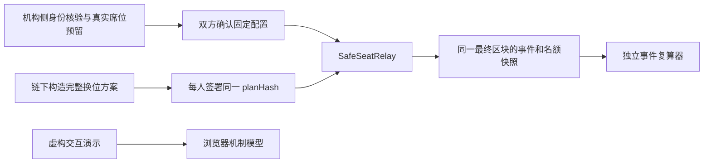

# 多一个人 · 参赛实现方案 v0.2

## 产品定位

核心承诺：换到自己同意的新场次，才释放原有席位。两家独立机构先锁定真实预留的席位与资格，参加者签署同一份完整方案，合约一次性完成全部换位。不存在需要某人先退票的中间状态。

首要指标是同样供给下实际获配的人数，以及跨机构协调是否保留已有权利。空位接力可能增加一名参加者，闭环互换只改善时间匹配，不增加人数。没有合适方案时保持原状。演示使用构造数据，尚未证明真实换位环发生率或机构采用率。

## 从六份材料收敛到实现

| 原方案内容 | 当前落地 | 后续边界 |
| --- | --- | --- |
| 双机构联合确认容量、规则、名单 | `configHash` 固化双方地址、截止、条款摘要、初始持有者与资格；两位主办方分别确认 | 真实机构须自行预留并承认席位 |
| 同等供给提高获配人数 | 前端保留双场分配对照；合约主线改为保底换位与空位接力 | 不把演示增量外推为真实业务提升 |
| EIP-712、nonce、资格约束 | `lib/consent.mjs` 与 `SafeSeatRelay.sol`，签署整份 `planHash`；完整钱包浏览器流程已通过隔离 Hardhat 三 EOA 账户验收，包括撤回、旧方案拒绝与新同意成功 | 本地链用 10143 仅匹配签名域，不是 Monad 数据；公共 Monad 独立钱包操作和真人试点待完成 |
| 一人最多一席 | 当前固定名册中一地址最多一席 | 防多地址和家庭单位核验由机构负责 |
| 公开复核 | `lib/replay.mjs`、`verify-events.mjs`、`verify-chain.mjs` | 文件复算只证明文件内部一致；实时来源须通过 RPC 验证 |
| Next.js、PostgreSQL、可靠代付队列 | 首次参赛框架采用静态 HTML/JS、viem 与 Solidity；免后端运行 | 队列、账户登录与生产服务待单独实施 |
| 测试网部署与真实性检查 | 产品合约已由 CreateX 测试夹具部署，完成缺签、撤回、旧方案拒绝、新同意成功与重放拒绝，以及字节码和部署溯源核验 | `config/challenge-proof.json` 记录最新撤回证明，`config/testnet-proof.json` 保留早期证明；独立部署模板 `config/monad.testnet.json` 仍为空，不可混用 |

这是保留来源方案核心约束后的明确范围调整。v0.1 的报名/定时联合分配与 v0.2 的已持有席位换位，不能混用接口或宣称已经全部实现。

## 模块与数据流

首页和失败挑战的浏览器机制模型只演示动作语义；其模拟按钮不会调用钱包或广播交易。独立本地 EVM 演示执行编译后的合约字节码，但网络编号为 31337。真实 Monad 证明运行于 10143，使用由同一控制者管理的虚构合约钱包；不能宣称三位真人已签名。新增独立钱包实验页与模拟页面分开，集成和验收状态见 `docs/QC-review.en.md`。

## 合约接口

| 接口 | 约束与结果 |
| --- | --- |
| 构造函数 | 两个不同的主办方；最多 12 席、12 个资格地址；截止、条款与初始归属不可更改 |
| `approvePool(configHash)` | 仅双方各自确认相同配置，双方齐备才可换位 |
| `hashPlan(moves)` | 按顺序对全部 Move 编码并哈希，顺序也是同意内容 |
| `consentDigest(planHash, move, validUntil)` | EIP-712 域绑定名称、版本、chainId 和部署地址 |
| `execute(moves, validUntil, signatures)` | 任何代发者可提交；逐一检查持有者、资格、nonce、签名、截止、目标和占位者，再同时清空旧位、写入新位 |
| `cancelConsent()` | 参加者递增自己的 nonce；只有撤回交易先被包含，旧签名才失效 |
| `getSeats()` / `seatOf` / `nonces` | 公开读取，可在指定区块复核 |

Consent 包含 `planHash, participant, fromSeat, toSeat, nonce, validUntil`。`fromSeat=0` 表示候补，`toSeat` 必须为有效席位。同一个人或目标不得重复。被占位置的原持有人必须也在本次方案中。截止采用严格小于，且签名截止不能晚于名额池截止。

## 信任边界

- 主办方决定资格和初始供给；该原型无法证明线下名额真实存在，也无法强制入场。
- 钱包地址、资格掩码、条款摘要和名额关系公开；地址匿名不等于不可关联。姓名、手机、年龄、证件留在机构侧。
- 第三方只能提交完整有效签名，不能代替参加者选择其他目标；交易排序仍影响撤回与执行的先后。
- 没有价格、转售、代币、保证金或管理员没收入口。合约没有进行生产安全审计。
- 最大批次 12 席用于有界演示；这不是全局最优匹配求解器，也不是并行吞吐量基准。

## 验收与状态

| 验收项 | 可运行命令 | 证据类型 |
| --- | --- | --- |
| 成功、缺签、撤回、截止、资格、重复、跨域、纯互换 | `pnpm test` | 本地 EVM 与模型测试 |
| 完整浏览器钱包流程 | `web/live.js`，由浏览器驱动本地 EIP-1193 测试桥 | `research/validation/wallet-local-browser-log.json`：5 笔本地交易、6 次类型化签名，三测试账户由一个操作者控制；不是 Monad 数据 |
| 实际字节码演示、失败保留、成功增配 | `pnpm demo:local` | `research/validation/local-demo.json` |
| 独立重建及篡改检测 | `pnpm verify:events` | 文件一致性，不替代真实 RPC 来源 |
| Monad 网络编号及 finalized 读取 | `pnpm check:network` | `research/validation/network.json` 的时间点快照 |
| 测试网最新撤回、拒绝与成功路径 | `node scripts/verify-challenge-proof.mjs <部署交易> <证明交易>` | `research/validation/cancellation-proof.json`；真实取消 nonce、三次内部拒绝、新方案成功、同一块事件和快照 |
| 早期缺签与重放证明 | `node scripts/verify-testnet-proof.mjs <部署交易> <证明交易>` | `research/validation/monad-proof-evidence.json`；早期两次内部拒绝，单独保留 |
| 独立直接部署核验模板 | `pnpm verify:chain` | 配置模板尚为空；缺少地址和部署身份时按设计失败。不能用于验证 CreateX 夹具 |
| 网页部署包 | `pnpm build` | `dist/`，仅包含显式允许的公开文件 |

直接部署核验模板需要真实部署地址、交易、区块和预期部署者；脚本检查 chainId、最终区块、成功回执、直接部署身份和编译后的运行时代码（排除 immutable 填充区）。已完成的夹具证明走独立核验器，另外验证 CreateX 代码哈希、实际 calldata、chain-bound guarded salt、预测地址、构造参数和参与者控制关系。最新证明在一笔成功外层交易内记录真实取消 nonce、缺签/撤回后旧方案/重放三次内部拒绝，以及新同意后的成功接力；不能称为三笔失败交易，也不能推断真实网络竞态的排序结果。早期证明有两次内部拒绝且没有撤回，单独保留。

最新产品合约：`0xeAC3414f47aD5Fd2F12B8A88575eBc04c4EaF378`。撤回证明交易：`0x4694e41130890603ecc7b979a5e92880099fb3b66a46649a7a1ff735c46746d7`。早期产品合约 `0x7D7DAB361AB5cBA009541491886b4dC9B16c450b` 与证明交易 `0x20b562b401290c76d9d3070d79d8e6ac02cc80be5f504afc469cb5abc52907de` 单独保留。完整复现命令和限制见 `docs/testnet-proof.md`。浏览器下载文件复算检查文件内部一致性；只有实时 RPC 核验成功，才能称为刚刚独立核对了链上来源。

## 下一阶段

完整本地浏览器验收已经完成：建池与代码核验、两位主办方确认、三个 EOA 账户签同一方案、撤回后旧方案预检拒绝且席位不变、更新 nonce 后三份新签名执行，结果为 C/A/B。Hardhat 使用 10143 仅复现签名域，本地交易和最终状态不能用于宣传 Monad 最终性。公共 Monad 上独立钱包的全程操作仍待验证，真实机构供给预留、履约和换位需求见 `docs/pilot-plan.md`。生产资格系统、数据库队列、通知与签到不在本次完成状态中。用户已选择亲自提交，自动流程不得代为提交 MOJO 项目。
