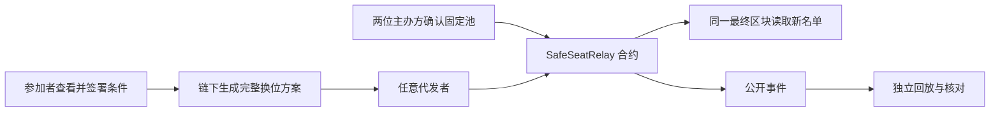

# 多一个人：保底换位，让空位接上候补者

2026-11-21 · 广州 · 决策稿 v0.2

**建议把参赛核心收敛为：你拿到认可的新位置，才释放旧位置；一串换位一起成功，还能接上一个候补者。** 保留原方案的跨机构同类活动场景，将“首次联合分配”降为背景与对照。“最大匹配算法上链”本身不足以构成有力创新。

这是基于六份附件、官方技术文档、原始项目页及一次经用户确认的 MOJO 导师反馈作出的产品判断。它不是已验证的市场需求，也不是全球首创证明。

## 1. 六份附件得到的结论

| 来源 | 已检查内容 | 对本次设计的影响 |
| --- | --- | --- |
| One_More_Person_Design_Pack_v0.1.zip | 25 项资源；分配器、验证器、原型与设计文档 | 独立复跑 22,240 组参考算法校验通过；证明小规模匹配正确，不能证明用户需要上链 |
| 多一个人 跨机构活动名额分配产品与技术方案.md | 完整产品、规则、签名、信任边界与失败恢复 | 保留多机构预留席位、参与者自主选择、可核验结果；缩减主办方后台与代发服务 |
| Interactive_Prototype.html | 与压缩包同名文件字节一致；三个视角和模拟状态机 | 明确是本地演示，没有合约、真实钱包或链上回执 |
| Product_Technical_Design.pdf | 12 页，包含交互与系统图 | 与 ZIP 内 PDF 并非同一字节版本；主要产品规则一致，不能把两份文件算作独立验证 |
| monad广州 介绍.pdf | 7 页图片逐页查看 | 确认广州活动、11 月 21 日日程、三人以内团队和现场演示导向 |
| Monad广州.pptx | 47 页正文及备注提取；重点第 4–5、17–33、37–46 页 | 新机制、边界实验、当天代码、上线链接和公开仓库优先。第 46 页 19:00 与比赛 API 不同，采用用户确认的 18:30 |

附件中的“已验证”已在本地重新运行；PPT 中的性能、功能和部署状态另以当日官方文档核对。没有把附件中的开发分工或文字指令当成用户新增授权。

## 2. 生活问题和第一批用户

**已报名的时间不方便，想换一个场次，却不敢先退掉手上的位置。** 另一端有人候补，别处还有空位；各主办方的名单分开管理，人工调换需要逐个确认，任何一个人先让出席位都要承担不确定性。

首个试点选两家社团的同主题免费工作坊。活动已经开放报名，双方愿意各划出少量真实名额，承认共同名单。先找成年参与者，避免首日同时处理监护授权、身份核验和儿童数据。实名信息留在机构侧。

成立前提是机构愿意冻结这些席位，并按协议最终名单接纳参加者。链不能阻止机构在自己的后台重复售出同一现实席位，也不能强迫场馆履约。若两家愿意统一交给一个运营方管理，统一数据库通常更省事；该产品不应强迫这种场景上链。

**需要验证的三个假设：** 两家愿意共同拿出供给；已获配者愿意表达替代时间；实际报名中有足够可行的换位路径。当前没有真实机构或真实用户数据，演示人物和路径均为构造样例。

## 3. 新核心：保底换位与空位接力

原型使用两家主办方、三个时间的三个席位。相较 v0.1 的两个场次，多一个时间用于展示两步接力；不是扩成活动平台。

| 人 | 原状态 | 本人认可的新状态 |
| --- | --- | --- |
| 小林 | 周六上午 A | 周六下午 B |
| 小陈 | 周六下午 B | 周日下午 C |
| 小雨 | 无席位，只能周六上午 | 周六上午 A |

C 原来为空。三个人共同签署同一方案后，一笔交易同时完成：小陈去 C、小林去 B、小雨接 A。**席位总量仍为 3，已获配人数从 2 变成 3。** 所有人在执行前保留旧状态；任何一项不成立，整笔回滚。

这是一条通向空位的接力路径，不要求先找到封闭交换环。两人互换也支持，但人数增量为 0；没有可行方案时明确保持现状。两种结果都应在演示中展示。

机制来自既有的匹配和原子交换思想。可争取的差异是将它们用于**机构共同认可、不可出售的活动席位，且所有原持有者都有新席位保底**。不要宣称发明了匹配算法、ACID 事务或原子交换。

### 必须成立的规则

- 每个参与账户在同一池里至多一席；当前实现是“一账户一席”，不等同于真实世界“一人一席”。
- 每个目标席位只能出现一次，不能挪走未参与本方案的持有者。
- 每人认可的目标满足机构预先锁定的资格范围；资格与当次意愿是两回事。
- 每人的签名绑定整个方案、本人原席位、新席位、nonce、截止时间，以及 EIP-712 的 chainId 和合约地址。
- 有席位者不能被分配到 0；任何成功换位都保留其一席。人数只会不变或增加。
- 撤回同意通过增加本人 nonce 完成，不退掉本人现有席位。它必须先被链上纳入，才能使后到的旧方案失效；不能承诺点击撤回就必定抢在执行前。
- 同一份方案不能重复执行；更换任意一位参与者或目标都需要重新收齐签名。

不承诺“所有方案里人数增量最大”或“排队绝对公平”。当前合约只验证安全、同意与资格；竞争方案的排序和全局最优选择是另一个机制问题。

## 4. 为什么普通工具不够，以及什么时候它们更好

| 现成方式 | 已核实的能力 | 应直接采用的场景 | 本项目需要额外证明的差异 |
| --- | --- | --- | --- |
| Luma | 满员候补、主办方单个或批量审批；候补按活动整体管理 | 单场活动报名、候补、发布与通知 | 不同机构控制的已有名额能否在共同授权下条件换位；官方候补文档未证明其提供此功能，也不能据此断言产品永远没有 |
| Eventbrite | 按票种或总容量开启候补，向候补者释放名额并设领取时限 | 售票、退票后补位、成熟运营流程 | 已有持有者之间的多方条件交换；官方营销页与帮助页对自动/人工释放表述不同，不能把自动补位当独有优势 |
| 广州市少年宫 | 实名预报名、公证抽签确定学位 | 公共机构招生活动 | 不应把“公开抽签/更公平报名”包装成新需求；跨机构换位仍需机构政策允许 |
| 共享表格＋统一数据库 | 在共同运营权限下可实现匹配、事务与审计 | 两家互信且愿意统一管理 | 合约降低对某个运营方管理员的依赖，供多端独立执行和复核；数据库本身也能原子提交 |

证据：[Luma 候补说明](https://help.luma.com/p/waitlist)、[Eventbrite 候补设置](https://www.eventbrite.com/help/en-us/articles/811539)、[Eventbrite 释放名额说明](https://support.eventbrite.com/hc/en-us/articles/34864613765266-How-to-release-tickets-to-the-waitlist)、[广州市少年宫招生通知](https://www.54cn.net/article/79473940011957249)。

产品可以成为机构现有报名流程后的“名额调整入口”。不必让机构迁走全部报名业务，也不应重新实现 Luma 的活动发现、邮件、售票和统计。

## 5. 往届项目查重

| 已核实项目 | 原机制 | 应避开的路线 | 当前可区分的机制 |
| --- | --- | --- | --- |
| [去中心化抢票平台 #96](https://mojo.devnads.com/projects/96) · 深圳 V2，2026-01-17 | 单场先到先得、单地址限购、成功后铸 ERC-721 门票 | 高并发抢票＋NFT 门票＋“链上公平” | 已有席位的条件接力，失败不退位；不靠手速分配 |
| [不鸽 #297](https://mojo.devnads.com/projects/297) · 武汉，2026-07-25 | 报名保证金、NFC 到场、爽约资金分配 | 押金、信用分、签到和惩罚爽约 | 解决到场前的时间协调与名额利用，不判断是否到场 |
| [AntForge #305](https://mojo.devnads.com/projects/305) | Agent 技能匹配、排他领任务、结果验证与奖励结算 | 多 Agent 工坊、并行任务赛道、任务报酬 | 现实活动席位的多人条件交换；并行存储设计本身不是独占创新 |
| [FairJoin 拼好团](https://github.com/veithly/fairjoin) | 固定费用分摊，后来加入让早期参与者可领差价 | “多一个人就少付钱”、费用返还、团购 | 增加可参加人数，不处理费用或资产收益。仓库内容已核实，赛事归属未单独核实 |

MOJO 导师用其往届语料返回“无严格撞车”，列出 #96 和 #297 两个相关项目，额度剩余 19/20。完整原文见 [导师反馈](mentor-feedback.md)。这属于该服务的检索判断，不构成对全球往届、未公开项目或所有同期队伍的排重保证。

本次补充搜索覆盖官方资料、Mojo 原页及关联仓库；公开项目列表页未返回完整列表，第三方 monadblitz.world 首页现为停放页，不作为完整档案依据。Parallel 深度研究因账号未授权而未执行；公开搜索与抓取已完成。没有因此声称“查遍了 400 多个项目”。

导师原文中“只有合约能原子完成”的说法过强。数据库事务同样可以；这里的差异在于**谁能改账、谁能独立提交，以及多个机构是否接受同一个执行边界**。

## 6. 核心产品只保留三步

1. **看我的原位，勾选可接受的新时间。** 首屏先回答时间、地点和“我的位置仍保留”；不要求普通参加者理解 TPS、nonce 或 gas。
2. **看懂换位方案，明确同意。** 同一张卡展示本人旧时间、新时间、有效期；说明全成才换位。没找到方案直接说明，不能伪造匹配。
3. **等待最终确认，出示新名额。** 区分已提交、暂定回执、最终确认；失败显示原位保留。核验、完整名单与区块证据放二级入口。

当前交互原型用于三分钟讨论，能够体验空位接力、两人互换、没有方案、缺少同意、撤回和过期。它使用模拟多人同意；真实钱包接入尚未完成，不把勾选框伪装成签名。

首日削减：活动广场、群聊、通知系统、自动资格发放、主办方运营后台、付款、代币、NFT 二级交易、押金、AI 推荐、积分和跨链。主办方在代码夹具中给定，两人分别确认固定池。

## 7. Monad 技术逐项对照第六份附件

| PPT 主题 | 当日核验及修正 | 本项目采用方式 |
| --- | --- | --- |
| 第 17–19 页：吞吐、出块和最终性 | 官方区分 10,000+ TPS 设计容量、300ms 主网观测出块和 600ms 协议最终性；都不是本应用端到端成绩 | 测量实际签名结束到纳入、到 finalized 的时间；正式票据等最终确认 |
| 第 20 页：异步执行 | 共识排序与执行分离；RPC 接受不是业务成功 | 保存交易哈希，核对回执状态与最终区块；超时进入核对中，不盲目创建第二笔操作 |
| 第 21 页：乐观并行 | 结果保持串行 EVM 语义，冲突可能重执行 | 每个池独立；取消同意只写本人 nonce。交换本身必须原子，不承诺一笔合约内部循环自动并行 |
| 第 22 页：MonadDB | 节点内部存储设计，不是网页要调用的数据库 SDK | 通过官方 RPC 和合约交互，不额外部署“MonadDB 后端” |
| 第 23 页：MIP-8 | 每页 128 连续 slot；首次 SLOAD 8100、同页之后 100。PPT 把 Ethereum 逐槽冷读标为 8100 不准确，Ethereum EIP-2929 是 2100；64800 对 8800 是旧 Monad 逐槽与同页读的示例比较 | 有界数组可利用局部性；不同 mapping 键并不会自动同页。不得把这组原语数字写成整笔交易节省倍数 |
| 第 23 页：线性内存 | MIP-3 为线性内存扩展，单笔最多 8MB，仍受交易 gas 上限约束 | 为有界方案检查提供空间，不把匹配规模无限放大 |
| 第 23/26 页：合约大小 | 128KB 对以太坊 24,576 字节约为 5.33 倍，PPT“4 倍”不准确 | 目前小合约无需靠接近上限证明创新 |
| 第 23 页：P256 | 已提供 EIP-7951 的 P256 验签；完整 passkey 登录仍需账户、WebAuthn 和恢复机制 | 之后可配合合约账户降低签名门槛；当天先验证 EIP-712，不能把预编译等同完整登录产品 |
| 第 24 页：本地 mempool | 缩小传播范围不等于所有观察者都无法看到交易；不保证公平排序 | 方案绑定完整成员与 nonce，复制广播也不能改受益者；不靠手续费优先证明公平 |
| 第 24 页：Cadence/BTX | 官方资料仍区分研究、模拟/试验和生产化；没有据此证明本次测试网已部署 | 不依赖 100ms/200ms、加密意愿或无 MEV 的假设 |
| 第 26 页：sendRawTransactionSync | 可以较早返回回执；回执仍可能对应非最终区块，节点也可能不支持或请求超时 | 能用则作为反馈优化，仍保留异步恢复、状态校验与 finalized 读取 |
| 第 26 页：Execution Events | 同节点主机上运行 C/C++/Rust 消费共享内存队列，不是普通网页直接订阅 | MVP 用 RPC 日志；跨块历史做有界分页。无需上完整索引平台 |
| 第 30 页：Viem/Monad Foundry | EVM 工具链可复用；通用本地 EVM 不能替代 Monad 特有计价测试 | 当前本地字节码测试验证机制，实网 gas、延迟和最终性另测 |
| 第 31–33 页：x402/ERC-8004/PWA | 分别服务支付、Agent 身份及移动体验，不是每个产品都必须接入 | 不加入本次核心；移动网页即可验证体验 |

依据：[官方性能口径](https://docs.monad.xyz/introduction/why-monad)、[并行执行](https://docs.monad.xyz/monad-arch/execution/parallel-execution)、[协议差异](https://docs.monad.xyz/developer-essentials/differences)、[Opcode 定价](https://docs.monad.xyz/developer-essentials/opcode-pricing)、[MIP-8](https://mips.monad.xyz/MIPs/MIP-8)、[EIP-2929](https://eips.ethereum.org/EIPS/eip-2929)、[RPC 状态差异](https://docs.monad.xyz/reference/rpc-differences)、[Execution Events](https://docs.monad.xyz/execution-events)、[Cadence 官方介绍](https://monad.xyz/blog/cadence-multiple-concurrent-proposers)、[11 月技术展望](https://monad.xyz/blog/big-four-blockchain-properties)。

新安装的 monskills 部分文字仍写 400ms/800ms、200M block gas 等旧参数。使用技能的方法指导，但网络数字以当日官方页面和 RPC 为准，不直接复制这些旧值。2026-11-21 本地只读检查确认 Testnet chainId=10143、区块 gasLimit=150,000,000，记录在 `research/validation/network.json`。

## 8. 技术架构与已实现原型

`SafeSeatRelay.sol` 是当天新写的机制原型。每个合约实例对应一个固定池：两位不同主办方、席位、初始持有者、资格和截止时间被锁定；双方确认同一 configHash 后才可执行。最多 12 个席位、12 个参与账户。

`execute(moves, validUntil, signatures)` 先检查整批资格、持有状态、唯一性和签名，再统一清旧位置、写新位置。任何人可广播，代发者没有改写权。`cancelConsent()` 递增本人 nonce。合约不接收业务付款，也没有管理者没收名额或随意改规则的接口。

使用 OpenZeppelin EIP712 与 SignatureChecker；支持库层面的 EOA/ERC-1271 验签路径。当前自动测试重点是 EOA，不能把库兼容性当作所有嵌入式钱包已联调。机构实名数据不进合约；地址、资格和换位关系仍公开可关联。

参考实现不声称找到全局最优方案。独立回放验证 SeatSeeded 和同笔交易内的 SeatMoved 事件生成的最终名单与合约一致；真实环境需要在 finalized 的同一 blockHash/高度固定快照，而非混读变化中的 latest。

## 9. 探索 Monad 的边界：可复现实验，而非功能堆叠

| 实验 | 控制变量和操作 | 记录什么 | 能得出的结论 |
| --- | --- | --- | --- |
| 2、3、6、12 人方案 | 同一合约逻辑，不同批大小；先全部成功，再每组撤回一人 | gas estimate、实际设置 gas limit、费用、广播至纳入/最终确认的 p50/p95、失败后原位 | 该受测 RPC 与合约下的可用批大小和体验，不是全链 TPS |
| 独立池与热点池 | 相同总交易数、钱包数、并发上限；只改变是否竞争相同席位 | 成功/回滚数、延迟、nonce 队列、RPC 限流 | 应用冲突与排队行为；若没有节点 trace，不能证明节点实际并行线程数 |
| 连续槽与散列槽 | 单独基准合约，业务等价、相同输入；在 Monad 上估算/执行 | 页内/跨页 gas limit、执行日志、合约版本 | MIP-8 对本布局的影响，不把 Ethereum 的本地 gas 当 Monad gas |
| 故障恢复 | 广播后断开客户端，再按同一交易哈希恢复 | 是否重复执行、最终名单与签名 nonce | 接收确认与最终成功分离是否可靠 |

公共测试网 RPC 文档标注约 20 req/s。先以全局最多 10 RPC req/s、有界批次数运行；更高负载需自有或获准的专用 RPC。使用测试资产和明确的交易预算，不能对公共服务无限压测。首次建议每组 20 个有效样本；样本不足就只报告原始观测，不作统计承诺。

Monad 按 **gas limit** 收费，不能用 gasUsed 冒充支付成本；不要把单笔 limit 设成整个区块上限。使用模拟、估算与明确上限；签名等待和人为操作耗时另外记录。[Gas 计价](https://docs.monad.xyz/developer-essentials/gas-pricing)、[Testnet 限流和网络信息](https://docs.monad.xyz/developer-essentials/testnet)。

## 10. 三分钟演示

**0:00–0:25**：小林想从上午换到下午，但不敢先退；旁边有人候补，周日还空着一席。

**0:25–1:05**：展示三人的同一换位方案。收齐同意后执行，2 人变 3 人。强调原位在确认前一直保留。

**1:05–1:45**：重置，模拟其中一人撤回，再执行旧方案。整笔失败，逐个看原席位均未变化。这是核心证明。

**1:45–2:15**：两人互换只解决时间适配，人数增加为零；没有方案就保持现状。避免只展示精心挑选的正增量例子。

**2:15–2:45**：实链版本展示交易、最终区块和回放结果；当前本地原型只能展示机制记录，不能使用假的交易证据替代。

**2:45–3:00**：说明正在验证两家机构是否愿意接入以及真实换位需求。研究目标是让跨机构的小额高频协调可用，不是证明这件事只有 Monad 能做。

## 11. 参赛配置与提交边界

- Agent 已注册并认领，名称“圆滚滚的海豹”；凭证只在 `.mojo/agent.json`，目录内部 `.gitignore` 为 `*`，根目录也忽略 `.mojo/`。
- 3 个 MOJO 技能与 10 个 monskills 主题已安装于 `.agents/skills/`；`.claude/skills` 指向同一目录；未新建 CLAUDE.md。
- 截止已由用户确认：2026-11-21 18:30 北京时间。16:30 起收口，18:00 起冻结；提醒写入 AGENTS.md。只有聊天继续运行时才会执行检查，不承诺后台自动提醒。
- 比赛 API 返回 ongoing、团队最多 3 人，当前 project=null。绑定成功不等于作品已经提交。
- 提交还需要真实可访问演示、公开 GitHub、至少一张本人上传的截图，以及最终提交内容确认；团队项目须由队长操作。提交成功后仍是 pending 人工审核。

**当前交付是定位研究、项目配置、合约机制原型及明确标注模拟的交互演示。** 实链部署、机构试点、正式钱包界面、性能结果与公开参赛提交不能写成已完成。完整验证结果见项目 README 和 `research/validation/`。
